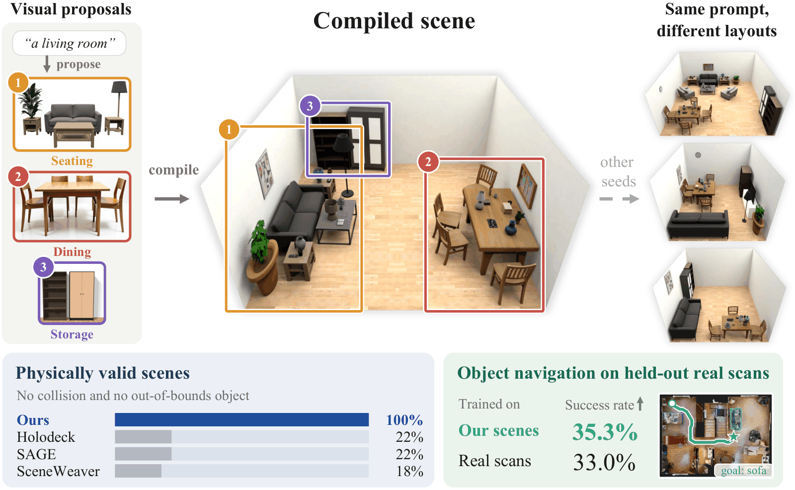

<div align="center">

# SceneBloom: Agentic Indoor Environment Generation with Realistic and Diverse Layouts for Embodied Learning

[](https://arxiv.org/abs/2610.32978)
[](https://tinaliu0123.github.io/scenebloom/)

</div>

<p align="center">
  
</p>

SceneBloom is an agentic framework that generates realistic, diverse, and simulation-ready indoor environments for embodied learning. It combines visual layout sampling with contract-guided 3D compilation.

## 📝 Table of Contents

- [Project Structure](#project-structure)
- [Installation](#installation)
- [Download Models and Assets](#download-models-and-assets)
- [Quick Start](#quick-start)
- [Usage](#usage)
  - [Scene Generation](#scene-generation)
  - [Export to Habitat](#export-to-habitat)
  - [Outputs](#outputs)
- [Citation](#citation)

## Project Structure

```
scenebloom/
├── scenebloom/
│   ├── sampling/            # hierarchical visual sampling
│   │   ├── zoning/          #   functional zoning with retrieved exemplar rooms
│   │   └── proposals/       #   layout proposal of each zone with FLUX and our LoRA adapters
│   ├── compilation/         # contract-guided 3D compilation
│   │   ├── lifting/         #   lifting and relation extraction
│   │   ├── fitting/         #   hierarchical layout fitting
│   │   ├── refinement/      #   relational refinement
│   │   └── completion/      #   wall objects and small objects
│   ├── render/              # Genesis rendering, floor and wall materials
│   ├── utils/
│   ├── pipeline.py
│   ├── cli.py
│   └── export.py
├── scripts/
│   ├── generate_scene.sh
│   ├── download/
│   └── build_index/
├── asset_generation/
├── envs/
├── data/
└── checkpoints/
```

## Installation

```bash
git clone https://github.com/Tinaliu0123/scenebloom.git
cd scenebloom
bash envs/install_scenebloom.sh
conda activate scenebloom
cp .env.example .env    # fill in OPENROUTER_API_KEY and HF_TOKEN
```

[envs/README.md](envs/README.md) describes the optional `habitat` environment for loading the exported scenes in habitat-sim.

> [!NOTE]
> - `OPENROUTER_API_KEY` is used to call Qwen3-VL-8B-Instruct through [OpenRouter](https://openrouter.ai) for zoning, relation extraction and scene completion.
> - `HF_TOKEN` must belong to a Hugging Face account that has accepted the license of FLUX.1 [dev], which is a gated model.

## Download Models and Assets

```bash
bash scripts/download/download_models.sh            # third-party models (about 42 GB)
bash scripts/download/download_assets.sh            # SceneBloom assets, materials, M3DLayout (about 3 GB)
bash scripts/build_index/build_retrieval_index.sh
```

`download_assets.sh` saves our [LoRA adapters](https://huggingface.co/tina390/SceneBloom-AssetLoRAs) and [object meshes](https://huggingface.co/datasets/tina390/SceneBloom-Assets) to `data/lora_assets/` and the AmbientCG floor and wall materials to `data/materials/`. The asset library is extensible, and we will add more assets to it. The third-party models and data of each stage are listed in the README of that stage: [sampling](scenebloom/sampling/README.md), [compilation](scenebloom/compilation/README.md) and [render](scenebloom/render/README.md).

## Quick Start

```bash
bash scripts/generate_scene.sh "a home office" outputs/office
```

This runs the whole pipeline on one GPU and writes the scene to `outputs/office/`; [Outputs](#outputs) lists its files.

## Usage

### Scene Generation

```bash
bash scripts/generate_scene.sh "<prompt>" <out_dir> [--seed N] [--no-export]
```

The prompt describes one of five room types: bedroom, living room, dining room, office or bathroom. `--seed N` sets the random seed of the run; without it, each run draws a new seed and prints it. `--no-export` stops before the Habitat export.

### Export to Habitat

```bash
python -m scenebloom.export outputs/office outputs/office/habitat
```

This writes `scene.glb`: the textured floor and walls and the placed meshes in one file, which habitat-sim loads directly as a scene. `generate_scene.sh` runs this step unless `--no-export` is given.

### Outputs

```
<out_dir>/
├── scene_layout.json          # final layout: objects, poses, mesh ids, room shell
├── material_assignment.json   # floor and wall materials
├── proposals/                 # FLUX layout proposal of each zone
├── renders/                   # top_down.png and oblique.png, rendered with Genesis
└── habitat/scene.glb          # Habitat scene
```

## Citation

If you find this work useful, please cite our paper:

```bibtex
@article{liu2026scenebloom,
  title   = {SceneBloom: Agentic Indoor Environment Generation with Realistic and Diverse Layouts for Embodied Learning},
  author  = {Liu, Yuhan and Qin, Lianhui and Wan, Shenji},
  journal = {arXiv preprint arXiv:2610.32978},
  year    = {2026}
}
```
